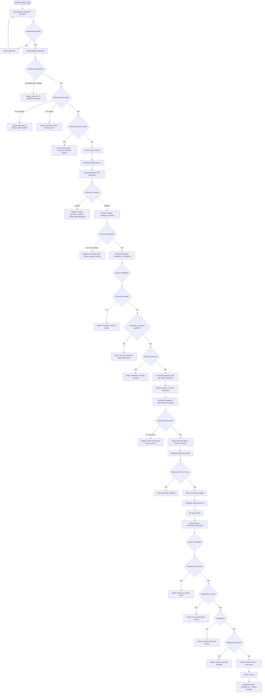
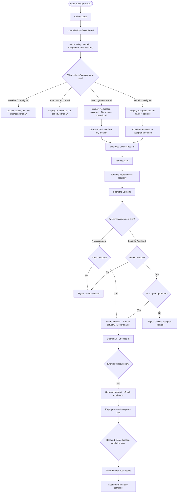
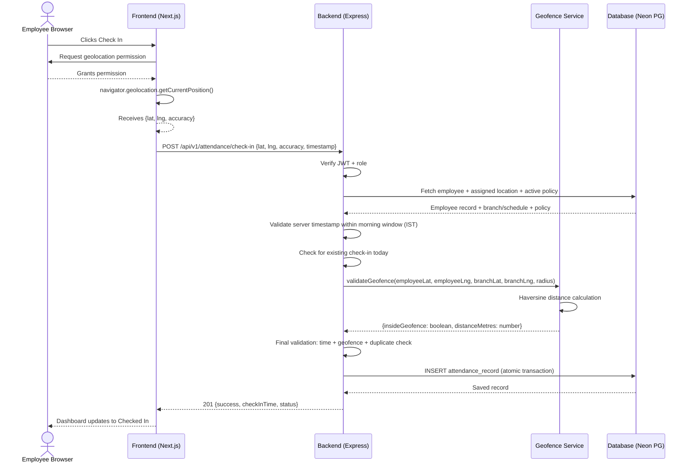
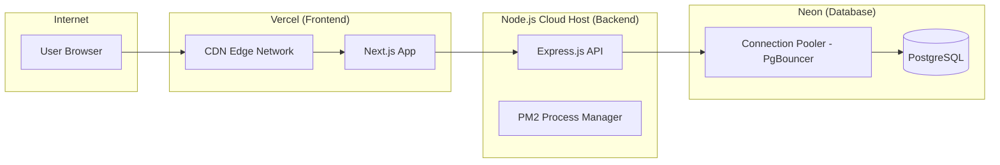

# LABA – Multi-Branch GPS Geofencing Attendance Management System
## Comprehensive Engineering Implementation Blueprint

**Document Version:** 1.0  
**Prepared:** November 2026  
**Status:** Planning & Architecture Phase — Implementation NOT yet begun  
**Primary Reference For:** Google Gemini (Implementation Agent)

---

> [!IMPORTANT]
> This document is a **planning artifact only**. No application code has been written, no packages have been installed, and no project files have been created. All implementation must wait for explicit approval from the project owner.

---

# PART A – PRODUCT UNDERSTANDING

---

## Section 1 – Executive Summary

LABA is a multi-branch pharmacy company operating approximately five to six branches across Andhra Pradesh, India. The company requires a centralized, web-based employee attendance management system that uses GPS geofencing to enforce location-based attendance verification for two distinct employee categories: Office Staff and Field Staff.

The system must prevent attendance fraud by validating that employees are physically within an authorized geographic boundary before accepting a check-in or check-out submission. The validation must be performed server-side, not client-side, so that employees cannot bypass the restriction by modifying browser behavior or submitted coordinates.

The system will serve four user roles: Super Admin, Admin, Office Staff, and Field Staff. It must be accessible via modern mobile and desktop browsers, requiring no native application installation.

The core technical platform is a Next.js frontend, an Express.js REST API backend, a Neon PostgreSQL cloud database managed via Prisma ORM, and standard secure authentication. The application will be deployed on Vercel (frontend) and a suitable Node.js cloud host (backend).

This document is the authoritative engineering reference for all implementation work. It must be followed precisely. Any deviation must be documented with a technical justification.

---

## Section 2 – Business Objectives

| # | Objective | Priority |
|---|-----------|----------|
| 1 | Prevent attendance fraud by enforcing GPS-based geofencing at the server | Critical |
| 2 | Support both Office Staff (fixed location) and Field Staff (dynamic location) under a single platform | Critical |
| 3 | Provide Super Admin and Admin with real-time visibility into daily attendance across all branches | Critical |
| 4 | Allow administrators to configure attendance schedules, geofence parameters, and policies without code changes | Critical |
| 5 | Generate downloadable Excel attendance reports for HR and management use | High |
| 6 | Maintain a full, tamper-evident audit trail for all administrative actions | High |
| 7 | Support a scalable multi-branch structure that accommodates new branches without code modifications | High |
| 8 | Provide a clean, professional, mobile-first employee interface that minimizes friction for daily attendance | High |
| 9 | Enable a controlled administrative workflow for handling missed attendance and correction requests | High |
| 10 | Lay a maintainable foundation that can accommodate future features such as leave management, payroll integration, and native mobile applications | Medium |

---

## Section 3 – Complete Requirement Analysis

### 3.1 Stakeholders

| Stakeholder | Role in System | Primary Concern |
|-------------|----------------|-----------------|
| LABA Management | Super Admin users | Organization-wide visibility, policy control, audit capability |
| Branch Managers / HR | Admin users | Daily attendance monitoring, employee management, report downloads |
| Pharmacy office employees | Office Staff | Simple and reliable daily check-in and check-out from fixed branch |
| Traveling field agents | Field Staff | Location-aware attendance from dynamic daily assignment |

### 3.2 Core System Constraints

- **No face recognition, biometrics, or AI** – the system must rely exclusively on GPS geofencing, employee authentication, and time-window validation.
- **No offline attendance buffering in MVP** – attendance requires live network connectivity. Future consideration only.
- **Browser-only in MVP** – no native Android or iOS application. Progressive Web App (PWA) characteristics are acceptable but not required as MVP scope.
- **Indian Standard Time (IST) is authoritative** – all attendance timestamps must use `Asia/Kolkata`. Employee device clocks must not be trusted.
- **Backend is authoritative for location validation** – the frontend captures and transmits coordinates; the backend performs all geofence calculations.
- **Neon PostgreSQL is the production database** – no self-hosted PostgreSQL required.

### 3.3 Identified Ambiguities and Explicit Assumptions

The following requirements are ambiguous. Each has a documented assumption and recommended default.

| # | Ambiguous Area | Assumption / Decision |
|---|---------------|----------------------|
| A1 | Whether each branch has a unique attendance policy or shares company defaults | **Decision:** Company-wide defaults apply. Admin can override per-branch or per-employee where the schema supports it. Policy versioning is applied at company level in MVP; branch-level overrides are a future enhancement. |
| A2 | Whether Field Staff can have multiple location assignments on the same day | **Decision:** One primary active location assignment per Field Staff per calendar date. If the business genuinely requires multiple locations per day, this becomes a future enhancement. The schema will support it without breaking changes. |
| A3 | Whether Admin accounts are branch-specific or company-wide | **Decision:** Admin accounts are company-wide by default. Super Admin can restrict an Admin to specific branches through a branch-access configuration table. Full branch restriction enforcement is Phase 3+ work. |
| A4 | What constitutes a "work date" when the attendance window crosses midnight | **Decision:** The work date is the calendar date on which the morning check-in window opens. If morning starts at 23:00 and closes at 23:30, the work date is that calendar date. Midnight-crossing windows are explicitly not supported in MVP; the system will validate and reject such configurations. |
| A5 | Whether employees can apply for leave within this system | **Decision:** Leave management is explicitly excluded from MVP. The absence display must note "No scheduled leave" rather than conflating absence with leave. |
| A6 | Whether holidays are managed in this system | **Decision:** A holidays table will be included in the schema (future-safe), but holiday configuration UI and automatic absence suppression on holidays is a Phase 2+ enhancement. The MVP will store holidays but not automatically apply them to attendance validation. |
| A7 | Maximum GPS accuracy threshold for rejecting submissions | **Decision:** Default accuracy threshold is 100 metres. If the browser reports GPS accuracy worse than this threshold, the system will warn the employee and allow a retry. The threshold must be configurable per company policy. |
| A8 | Whether the work report is required at check-out for all employee types | **Decision:** Yes. Both Office Staff and Field Staff must submit a mandatory work report before check-out. This is a universal rule. |
| A9 | Whether "Field Staff" can be assigned to a permanent branch like Office Staff | **Decision:** Field Staff are defined by their dynamic location nature. If a Field Staff member is permanently stationed at one location, Admin can assign them a seven-day repeating schedule with the same location every day. The employee type itself does not change. |
| A10 | Contact ID mentioned alongside Employee ID – what is it? | **Decision:** Contact ID is interpreted as a secondary identifier (possibly a CRM or HR system reference). It will be stored as a nullable field on the employee record. It does not affect authentication or attendance logic. |

---

## Section 4 – Functional Requirements

### 4.1 Authentication and Authorization

- FR-AUTH-01: All users must authenticate with an email address and password.
- FR-AUTH-02: Passwords must be hashed using bcrypt (minimum 12 rounds) or Argon2id.
- FR-AUTH-03: Sessions must be managed using HTTP-only secure cookies with an appropriately scoped JWT or server-side session. The implementation plan recommends JWT stored in HTTP-only cookies.
- FR-AUTH-04: Every API endpoint must independently verify the authenticated user's role and permissions.
- FR-AUTH-05: Session tokens must expire after a configurable period (default: 8 hours for employees, 12 hours for admins).
- FR-AUTH-06: Failed login attempts should be rate-limited (maximum 5 attempts per 15 minutes per IP/email).

### 4.2 Employee Management

- FR-EMP-01: Super Admin and Admin can create employee accounts.
- FR-EMP-02: Each employee has a unique Employee ID, Contact ID (optional), full name, email, mobile number, role, and profile.
- FR-EMP-03: Employees are classified as either Office Staff or Field Staff.
- FR-EMP-04: Office Staff are assigned to exactly one branch at a time.
- FR-EMP-05: Field Staff have dynamic daily location assignments managed by Admin.
- FR-EMP-06: Employee accounts can be suspended or deactivated (soft delete, not hard delete).
- FR-EMP-07: Suspended employees cannot authenticate or mark attendance.
- FR-EMP-08: Employee profile changes must be logged in the audit log.

### 4.3 Branch Management

- FR-BRN-01: Super Admin and Admin can create and manage branches.
- FR-BRN-02: Each branch has a unique Branch ID, branch name, branch code, address, district, state, latitude, longitude, geofence radius, and status.
- FR-BRN-03: Branch GPS coordinates and geofence radius must be configurable by Admin.
- FR-BRN-04: Branches can be activated or deactivated.
- FR-BRN-05: Changes to branch GPS coordinates or geofence radius do not retroactively alter historical attendance records.
- FR-BRN-06: Multiple employees can be assigned to the same branch.

### 4.4 Attendance – Office Staff

- FR-OS-01: Office Staff can mark check-in only within their assigned branch's geofence.
- FR-OS-02: Check-in is accepted only within the configured morning attendance window.
- FR-OS-03: Check-out is accepted only within the configured evening attendance window.
- FR-OS-04: Check-out requires a prior successful check-in on the same work date.
- FR-OS-05: Check-out requires the employee to be inside their assigned branch's geofence.
- FR-OS-06: Check-out requires a mandatory non-empty work report.
- FR-OS-07: Duplicate check-ins on the same date must be rejected.
- FR-OS-08: Attendance timestamps are recorded in UTC and displayed in IST.

### 4.5 Attendance – Field Staff

- FR-FS-01: Field Staff check-in and check-out are validated against their daily assigned location if one exists.
- FR-FS-02: If no location is assigned for the day, attendance is accepted from any location (unrestricted).
- FR-FS-03: If the day is configured as a weekly off, attendance is blocked with an explanatory message.
- FR-FS-04: Admin must be able to assign a location per date or as a seven-day repeating schedule.
- FR-FS-05: Admin must be able to edit any individual day's assignment without recreating the full schedule.
- FR-FS-06: Schedule changes do not alter already-recorded attendance records.
- FR-FS-07: The system must not treat an unassigned day as a zero-radius geofence.
- FR-FS-08: When attendance is unrestricted (no location assigned), the system still records the employee's GPS coordinates if permission is granted.

### 4.6 Administrative Functions

- FR-ADM-01: Admin can view all attendance records within authorized scope.
- FR-ADM-02: Admin can download Excel reports.
- FR-ADM-03: Admin can review and approve or reject employee attendance correction requests.
- FR-ADM-04: Admin can manually create an attendance correction on behalf of an employee (with audit trail).
- FR-ADM-05: Admin can configure attendance policies (time windows, geofence defaults, report length limits).
- FR-ADM-06: Super Admin can view and manage Admin accounts.
- FR-ADM-07: Super Admin can view the full audit log.
- FR-ADM-08: Policy changes must specify effective date and must not alter historical records.

### 4.7 Reporting

- FR-RPT-01: Dashboard shows today's present, absent, late, and pending employees.
- FR-RPT-02: Excel exports are generated server-side with proper authorization checks.
- FR-RPT-03: Exports support daily, weekly, monthly, and custom date-range filters.
- FR-RPT-04: Exports include separate sheets for summary, present, absent, Office Staff, Field Staff, and corrections.

---

## Section 5 – Non-Functional Requirements

| NFR | Category | Requirement |
|-----|----------|-------------|
| NFR-01 | Performance | API response time must be under 2 seconds for attendance check-in/check-out under normal load |
| NFR-02 | Performance | Dashboard queries must return within 3 seconds for up to 500 employees |
| NFR-03 | Scalability | Architecture must support adding new branches without schema changes |
| NFR-04 | Security | All API endpoints must enforce server-side authorization |
| NFR-05 | Security | GPS coordinates must be transmitted only over HTTPS |
| NFR-06 | Security | Passwords must never be stored in plaintext |
| NFR-07 | Security | Audit logs must be append-only and not modifiable by Admin |
| NFR-08 | Reliability | Duplicate attendance submissions within 30 seconds must be idempotently handled |
| NFR-09 | Availability | System must target 99.5% monthly uptime (acceptable for Vercel + Neon tier) |
| NFR-10 | Maintainability | Code must be TypeScript throughout with strict mode enabled |
| NFR-11 | Maintainability | All secrets must be in environment variables; no hardcoded credentials |
| NFR-12 | Usability | Employee interface must be usable on a mobile browser without pinch-zooming |
| NFR-13 | Compliance | GPS records must comply with applicable Indian privacy regulations |
| NFR-14 | Timezone | All time calculations must use Asia/Kolkata as authoritative timezone |
| NFR-15 | Extensibility | Database schema must accommodate future leave, payroll, and shift modules |

---

## Section 6 – User Roles and Permission Matrix

```
LEGEND:  ✓ = Full Access   ◑ = Partial / Scoped Access   ✗ = No Access
```

| Capability | Super Admin | Admin | Office Staff | Field Staff |
|-----------|-------------|-------|--------------|-------------|
| **Authentication** | | | | |
| Login / Logout | ✓ | ✓ | ✓ | ✓ |
| Reset own password | ✓ | ✓ | ✓ | ✓ |
| Reset other user passwords | ✓ | ◑ (own employees) | ✗ | ✗ |
| **Employee Management** | | | | |
| Create employee accounts | ✓ | ✓ | ✗ | ✗ |
| View all employees | ✓ | ◑ (authorized branches) | ✗ | ✗ |
| Edit employee profiles | ✓ | ◑ | ✗ | ✗ |
| Suspend / deactivate employees | ✓ | ◑ | ✗ | ✗ |
| View own profile | ✓ | ✓ | ✓ | ✓ |
| **Branch Management** | | | | |
| Create branches | ✓ | ✓ | ✗ | ✗ |
| Edit branch GPS / geofence | ✓ | ✓ | ✗ | ✗ |
| View branch list | ✓ | ✓ | ◑ (own branch) | ✗ |
| Assign employees to branches | ✓ | ✓ | ✗ | ✗ |
| **Field Staff Scheduling** | | | | |
| Assign daily locations | ✓ | ✓ | ✗ | ✗ |
| Assign 7-day schedules | ✓ | ✓ | ✗ | ✗ |
| Edit individual day assignments | ✓ | ✓ | ✗ | ✗ |
| View own schedule | ✗ | ✗ | ✗ | ✓ |
| **Attendance Policy** | | | | |
| View current policies | ✓ | ✓ | ◑ (relevant fields) | ◑ (relevant fields) |
| Modify company-wide policies | ✓ | ✗ | ✗ | ✗ |
| Modify branch-level policies | ✓ | ◑ | ✗ | ✗ |
| **Attendance – Employee Actions** | | | | |
| Mark morning check-in | ✗ | ✗ | ✓ | ✓ |
| Mark evening check-out | ✗ | ✗ | ✓ | ✓ |
| Submit work report | ✗ | ✗ | ✓ | ✓ |
| Request attendance correction | ✗ | ✗ | ✓ | ✓ |
| View own attendance history | ✓ | ✓ | ✓ | ✓ |
| **Attendance – Admin Actions** | | | | |
| View all attendance records | ✓ | ◑ | ✗ | ✗ |
| View present / absent employees | ✓ | ✓ | ✗ | ✗ |
| Approve correction requests | ✓ | ✓ | ✗ | ✗ |
| Reject correction requests | ✓ | ✓ | ✗ | ✗ |
| Manually create attendance entry | ✓ | ✓ | ✗ | ✗ |
| **Reporting** | | | | |
| Download Excel reports | ✓ | ✓ | ✗ | ✗ |
| View dashboard summaries | ✓ | ✓ | ✗ | ✗ |
| **Audit and Security** | | | | |
| View audit logs | ✓ | ✗ | ✗ | ✗ |
| Manage Admin accounts | ✓ | ✗ | ✗ | ✗ |
| Configure Super Admin permissions | ✓ | ✗ | ✗ | ✗ |

---

## Section 7 – Office Staff Workflow



---

## Section 8 – Field Staff Workflow



---

## Section 9 – Administrative Workflows

### 9.1 Employee Creation Workflow

1. Admin navigates to Employee Management → Add Employee.
2. Admin selects employee type: Office Staff or Field Staff.
3. Admin fills in: full name, email, mobile, Contact ID (optional), assigned branch (Office Staff) or no branch (Field Staff).
4. System generates a unique Employee ID.
5. System creates login credentials (temporary password or invite link).
6. Employee record is saved with status: Active.
7. Audit log entry is created: "Employee created by [Admin name]".

### 9.2 Branch GPS Configuration Workflow

1. Admin navigates to Branch Management → Select Branch → Edit Location.
2. Admin uses a map interface to click the precise branch location.
3. System populates latitude and longitude from the map click.
4. Admin sets geofence radius in metres.
5. System shows a visual circle overlay on the map representing the geofence.
6. Admin saves. System validates coordinates are valid WGS84 values.
7. System records the previous coordinates in a branch location history table.
8. Audit log entry is created: "Branch GPS updated by [Admin name] – previous: X,Y → new: A,B".

### 9.3 Field Staff Schedule Assignment Workflow

1. Admin navigates to Field Staff → Select Employee → Schedule.
2. Admin selects the scheduling mode: Single Day or Seven-Day Week.
3. For Single Day: Admin picks a date, enters location name, address, latitude, longitude, geofence radius, and whether attendance is enabled.
4. For Seven-Day Week: Admin fills in a table with all seven days. Each row is independently editable.
5. Admin saves. System validates all coordinates and time configurations.
6. Each day's assignment is stored as an independent schedule record linked to the employee and date.
7. If a schedule record already exists for a date, Admin is warned and can overwrite.
8. Previous schedule is preserved in history. Audit log is updated.

### 9.4 Attendance Correction Workflow

1. Employee submits a correction request from their dashboard.
2. Employee provides a reason (minimum 20 characters).
3. Request is stored with status: PENDING.
4. Admin sees the request in the Corrections section of the dashboard.
5. Admin reviews: views requested correction type, employee's reason, the original attendance state.
6. Admin approves or rejects with a written reason.
7. If approved: System creates or updates the attendance record with status: CORRECTED.
8. Original record state is preserved in an attendance corrections table.
9. Audit log records: who made the change, what changed, when, and why.
10. Employee sees updated attendance status.

---

## Section 10 – Business Rules Summary

| Rule ID | Rule | Scope |
|---------|------|-------|
| BR-001 | Check-in is only accepted within the configured morning window | Both |
| BR-002 | Check-out is only accepted within the configured evening window | Both |
| BR-003 | Check-out requires a successful check-in on the same date | Both |
| BR-004 | Office Staff must be inside their branch geofence to check in and out | Office Staff |
| BR-005 | Field Staff must be inside their daily assigned geofence if one exists | Field Staff |
| BR-006 | If no location is assigned to a Field Staff on a date, attendance is unrestricted | Field Staff |
| BR-007 | An explicitly configured weekly off blocks attendance entirely | Both |
| BR-008 | A missing schedule is NOT treated as a weekly off | Field Staff |
| BR-009 | Attendance timestamps use server time in UTC, displayed in IST | Both |
| BR-010 | Employee device clock is not authoritative | Both |
| BR-011 | Duplicate check-ins on the same date are rejected | Both |
| BR-012 | Work report is mandatory for check-out (minimum 5 characters, no whitespace only) | Both |
| BR-013 | GPS accuracy must meet the configured threshold or the employee is warned | Both |
| BR-014 | Backend performs all geofence calculations; frontend cannot approve attendance | Both |
| BR-015 | Historical attendance records must never be silently modified | Both |
| BR-016 | All corrections must be audited with before/after state | Both |
| BR-017 | Policy changes are effective from a specified date and do not alter history | Admin |
| BR-018 | Absent determination is only made after the morning window closes | Admin |
| BR-019 | No attendance window may cross midnight in MVP | Both |
| BR-020 | Super Admin controls Admin account permissions | Super Admin |

---

# PART B – SYSTEM ARCHITECTURE

---

## Section 11 – Proposed Architecture

The system uses a **Modular Monolith** architecture pattern with clear internal service boundaries. This avoids premature microservice complexity while maintaining logical separation that allows future extraction of individual services if required.

```mermaid
flowchart LR
    subgraph Client["Client Layer"]
        MB[Mobile Browser]
        DB[Desktop Browser]
    end

    subgraph Frontend["Frontend — Next.js on Vercel"]
        NX[Next.js App Router]
        subgraph Pages
            LP[Login Page]
            EMP_DASH[Employee Dashboard]
            ADMIN_DASH[Admin Dashboard]
            SA_DASH[Super Admin Dashboard]
        end
        subgraph Components
            GPS_MOD[GPS Module]
            CHECKIN[Check-In Component]
            CHECKOUT[Check-Out Component]
            REPORTS[Report Views]
        end
    end

    subgraph Backend["Backend — Express.js on Node.js Host"]
        subgraph Middleware
            AUTH_MW[Auth Middleware]
            AUTHZ_MW[Authz Middleware]
            RATE_LIM[Rate Limiter]
            VAL[Zod Validator]
        end
        subgraph Services
            AUTH_SVC[Auth Service]
            EMP_SVC[Employee Service]
            BRN_SVC[Branch Service]
            SCHED_SVC[Schedule Service]
            GEO_SVC[Geofence Service]
            ATT_SVC[Attendance Service]
            RPT_SVC[Report Service]
            AUDIT_SVC[Audit Service]
        end
        subgraph Routes
            AUTH_RT[/auth]
            EMP_RT[/employees]
            BRN_RT[/branches]
            SCHED_RT[/schedules]
            ATT_RT[/attendance]
            RPT_RT[/reports]
            ADMIN_RT[/admin]
        end
    end

    subgraph Database["Database — Neon PostgreSQL"]
        PRISMA[Prisma ORM]
        PG[(PostgreSQL)]
    end

    MB & DB --> NX
    NX --> AUTH_RT & EMP_RT & BRN_RT & SCHED_RT & ATT_RT & RPT_RT & ADMIN_RT
    AUTH_RT & EMP_RT & BRN_RT & SCHED_RT & ATT_RT & RPT_RT & ADMIN_RT --> AUTH_MW
    AUTH_MW --> AUTHZ_MW --> RATE_LIM --> VAL
    VAL --> AUTH_SVC & EMP_SVC & BRN_SVC & SCHED_SVC & GEO_SVC & ATT_SVC & RPT_SVC & AUDIT_SVC
    ATT_SVC --> GEO_SVC
    AUTH_SVC & EMP_SVC & BRN_SVC & SCHED_SVC & ATT_SVC & RPT_SVC & AUDIT_SVC --> PRISMA
    PRISMA --> PG
```

---

## Section 12 – Frontend Architecture

### 12.1 Technology

- **Framework:** Next.js 14+ with App Router
- **Language:** TypeScript (strict mode)
- **Styling:** Tailwind CSS with custom design tokens
- **State Management:** React Context API for auth state; React Query (TanStack Query) for server state, caching, and mutations
- **Forms:** React Hook Form with Zod resolver for client-side validation
- **Maps:** Leaflet.js (open-source, no API key required for map tile rendering) with react-leaflet wrapper. Use OpenStreetMap tiles.
- **HTTP Client:** Axios with interceptors for authentication headers and error handling
- **Icons:** Lucide React (minimal, consistent icon set)

### 12.2 Routing Structure (App Router)

```
/                           → Redirect to /login or /dashboard based on auth
/login                      → Login page (public)
/dashboard                  → Role-based redirect
/dashboard/employee         → Office Staff or Field Staff dashboard
/dashboard/admin            → Admin dashboard
/dashboard/super-admin      → Super Admin dashboard
/dashboard/admin/employees  → Employee management
/dashboard/admin/branches   → Branch management
/dashboard/admin/schedules  → Field Staff schedule management
/dashboard/admin/attendance → Attendance management
/dashboard/admin/reports    → Reports and Excel export
/dashboard/admin/policies   → Attendance policy configuration
/dashboard/admin/corrections → Correction request management
/dashboard/super-admin/admins → Admin account management
/dashboard/super-admin/audit  → Audit log viewer
/unauthorized               → 403 page
/404                        → Not found page
```

### 12.3 Key Frontend Principles

- Server-side rendering (SSR) for the initial authenticated page loads.
- Client-side navigation after initial load for dashboard interactivity.
- Route guards implemented via Next.js middleware checking JWT cookie presence and role claim.
- GPS access is requested on the client, coordinates are transmitted to the backend.
- No geofence calculation on the client.
- All sensitive operations confirm authorization through the backend response, not client-side button visibility alone.

---

## Section 13 – Backend Architecture

### 13.1 Technology

- **Runtime:** Node.js 20 LTS
- **Framework:** Express.js 5
- **Language:** TypeScript (strict mode, compiled to JavaScript for production)
- **ORM:** Prisma 5 with PostgreSQL adapter
- **Validation:** Zod for all request schemas
- **Authentication:** JWT stored in HTTP-only cookies; jsonwebtoken package
- **Password Hashing:** bcrypt (12 rounds)
- **Excel Generation:** ExcelJS
- **Date/Time:** date-fns with date-fns-tz for IST-aware operations
- **Rate Limiting:** express-rate-limit
- **Logging:** Winston (structured JSON logs)
- **CORS:** cors package, configured for frontend domain only

### 13.2 Backend Folder Structure

```
backend/
├── src/
│   ├── config/
│   │   ├── database.ts          # Prisma client singleton
│   │   ├── env.ts               # Environment variable validation (Zod)
│   │   └── constants.ts         # App-wide constants
│   ├── middleware/
│   │   ├── authenticate.ts      # JWT verification middleware
│   │   ├── authorize.ts         # Role-based authorization factory
│   │   ├── rateLimiter.ts       # Rate limiting configuration
│   │   ├── validate.ts          # Zod request validation middleware
│   │   └── errorHandler.ts      # Global error handler
│   ├── routes/
│   │   ├── auth.routes.ts
│   │   ├── employee.routes.ts
│   │   ├── branch.routes.ts
│   │   ├── schedule.routes.ts
│   │   ├── attendance.routes.ts
│   │   ├── report.routes.ts
│   │   └── admin.routes.ts
│   ├── controllers/
│   │   ├── auth.controller.ts
│   │   ├── employee.controller.ts
│   │   ├── branch.controller.ts
│   │   ├── schedule.controller.ts
│   │   ├── attendance.controller.ts
│   │   ├── report.controller.ts
│   │   └── admin.controller.ts
│   ├── services/
│   │   ├── auth.service.ts
│   │   ├── employee.service.ts
│   │   ├── branch.service.ts
│   │   ├── schedule.service.ts
│   │   ├── geofence.service.ts   # Haversine distance + radius validation
│   │   ├── attendance.service.ts
│   │   ├── report.service.ts
│   │   ├── excel.service.ts
│   │   └── audit.service.ts
│   ├── schemas/
│   │   ├── auth.schema.ts        # Zod schemas for auth requests
│   │   ├── employee.schema.ts
│   │   ├── branch.schema.ts
│   │   ├── schedule.schema.ts
│   │   └── attendance.schema.ts
│   ├── types/
│   │   ├── express.d.ts          # Augment Express Request with user
│   │   ├── attendance.types.ts
│   │   └── common.types.ts
│   ├── utils/
│   │   ├── haversine.ts          # Haversine formula implementation
│   │   ├── timeWindows.ts        # IST time window validation
│   │   ├── idGenerator.ts        # Employee ID generation
│   │   └── responseHelpers.ts    # Standardized API responses
│   └── app.ts                    # Express app setup
├── prisma/
│   ├── schema.prisma
│   └── migrations/
├── tests/
│   ├── unit/
│   ├── integration/
│   └── fixtures/
├── .env.example
├── package.json
└── tsconfig.json
```

---

## Section 14 – Database Architecture

### 14.1 Core Design Principles

- Normalized relational design (3NF minimum).
- Soft deletes using `deletedAt` timestamps (never hard-delete employee, attendance, or audit records).
- Attendance timestamps stored in UTC; displayed in IST by application layer.
- Policy versioning by snapshot: when a policy is changed, the old version is preserved and a new version is created with an effective date.
- All GPS coordinates stored as `DECIMAL(10,7)` for sub-metre precision at equatorial scale.
- Audit log is append-only; no update or delete operations are permitted on audit records.

### 14.2 Key Entities

The database will contain the following primary tables:

1. `organizations` – LABA company record
2. `users` – Authentication entity for all roles
3. `employees` – Employee profile (linked 1:1 to users)
4. `branches` – Pharmacy branch locations with GPS
5. `branch_assignments` – History of employee→branch assignments
6. `field_staff_schedules` – Daily location assignments for Field Staff
7. `attendance_policies` – Versioned attendance configuration
8. `attendance_records` – Core check-in/check-out data
9. `attendance_corrections` – Correction request and resolution history
10. `work_reports` – Daily employee work reports (linked to attendance)
11. `audit_logs` – Append-only administrative action log
12. `holidays` – Company holiday calendar (future-ready)

---

## Section 15 – API Communication

### 15.1 API Design Principles

- RESTful conventions throughout.
- All responses follow a consistent envelope format.
- Errors return structured JSON with a code, message, and optional field-level details.
- Pagination uses cursor-based pagination for large datasets.
- All routes are prefixed with `/api/v1/`.

### 15.2 Standard Response Envelope

```typescript
// Success
{
  "success": true,
  "data": { ... },
  "meta": {
    "timestamp": "2026-11-09T17:25:30.000Z",
    "requestId": "uuid"
  }
}

// Error
{
  "success": false,
  "error": {
    "code": "ATTENDANCE_WINDOW_CLOSED",
    "message": "The attendance window for today has closed.",
    "details": null
  },
  "meta": {
    "timestamp": "2026-11-09T17:25:30.000Z",
    "requestId": "uuid"
  }
}
```

### 15.3 HTTP Status Code Usage

| Status | Usage |
|--------|-------|
| 200 | Successful GET, PUT, PATCH |
| 201 | Successful POST (resource created) |
| 400 | Validation error, bad request |
| 401 | Unauthenticated |
| 403 | Authenticated but unauthorized (wrong role) |
| 404 | Resource not found |
| 409 | Conflict (duplicate attendance, duplicate email) |
| 422 | Geofence validation failure, time window rejection |
| 429 | Rate limit exceeded |
| 500 | Internal server error |

---

## Section 16 – GPS and Geofencing Architecture

### 16.1 GPS Flow



### 16.2 Haversine Formula Implementation

```
Given two points (lat1, lon1) and (lat2, lon2):

R = 6371000 metres (Earth radius)
φ1 = lat1 in radians
φ2 = lat2 in radians
Δφ = (lat2 - lat1) in radians
Δλ = (lon2 - lon1) in radians

a = sin²(Δφ/2) + cos(φ1) × cos(φ2) × sin²(Δλ/2)
c = 2 × atan2(√a, √(1−a))
distance = R × c (in metres)
```

This provides metre-level accuracy for the distances involved (sub-10 km).

### 16.3 GPS Accuracy Policy

| Accuracy Value (metres) | Action |
|------------------------|--------|
| ≤ 50m (configurable threshold) | Accept immediately |
| 51–100m | Accept with a warning logged |
| > 100m (configurable rejection threshold) | Return warning to employee; allow retry |
| Permission denied | Block attendance; display explanation |
| Timeout / unavailable | Block attendance; display explanation |

The thresholds must be configurable in the attendance policy.

---

## Section 17 – Authentication Architecture

### 17.1 Authentication Flow

```mermaid
sequenceDiagram
    actor U as User
    participant FE as Frontend
    participant BE as Backend
    participant DB as Database

    U->>FE: Enter email + password
    FE->>BE: POST /api/v1/auth/login {email, password}
    BE->>DB: SELECT user WHERE email = ?
    DB-->>BE: User record (with hashed password)
    BE->>BE: bcrypt.compare(password, hash)
    alt Invalid credentials
        BE-->>FE: 401 Unauthorized
        FE-->>U: Show error
    else Valid credentials
        BE->>BE: Generate JWT {userId, role, employeeId}
        BE->>BE: Set HTTP-only cookie: token=JWT; Secure; SameSite=Strict
        BE-->>FE: 200 {user: {id, name, role, employeeType}}
        FE->>FE: Store user context (no token stored in JS memory)
        FE-->>U: Redirect to role-based dashboard
    end
```

### 17.2 JWT Structure

```json
{
  "sub": "user-uuid",
  "role": "ADMIN",
  "employeeId": "employee-uuid",
  "employeeType": "OFFICE_STAFF",
  "iat": 1731173130,
  "exp": 1731201930
}
```

### 17.3 Middleware Chain

Every protected route passes through:
1. `authenticate` – Verifies JWT from HTTP-only cookie.
2. `authorize(allowedRoles[])` – Checks role against allowed list.
3. `validate(zodSchema)` – Validates request body/params/query.
4. Controller → Service → Database.

---

## Section 18 – Attendance Processing Architecture

### 18.1 Check-In Processing Sequence (Detailed)

```
1. Receive POST /api/v1/attendance/check-in
2. authenticate middleware: Extract and verify JWT
3. authorize(['OFFICE_STAFF', 'FIELD_STAFF']) middleware
4. validate(checkInSchema) middleware: Validate lat, lng, accuracy types and ranges
5. attendance.controller.checkIn():
   a. Load employee from DB (include type, branch assignment or field schedule)
   b. Determine work date in IST from server clock
   c. Load active attendance policy for the work date
   d. Determine applicable location:
      - If OFFICE_STAFF: use branch GPS + radius
      - If FIELD_STAFF: query field_staff_schedules for today's date
        * If WEEKLY_OFF: return 422 with specific code
        * If ATTENDANCE_DISABLED: return 422
        * If LOCATION_ASSIGNED: use schedule GPS + radius
        * If NO_SCHEDULE: unrestricted mode
   e. Validate morning window: policy.morningStart ≤ serverTime ≤ policy.morningEnd (IST)
   f. Query attendance_records: does a record exist for this employee + work_date?
      If yes: return 409 DUPLICATE_CHECKIN
   g. If geofence required: call geofenceService.validate(...)
      If outside: return 422 OUTSIDE_GEOFENCE
   h. Begin Prisma transaction:
      - INSERT attendance_records with status=CHECKED_IN
      - INSERT audit_logs with action=CHECK_IN
   i. Commit transaction
   j. Return 201 with attendance record summary
```

### 18.2 Idempotency and Concurrency Protection

- Database has a unique constraint on `(employee_id, work_date)` for attendance_records.
- If two simultaneous check-in requests arrive, the second will fail with a database unique constraint violation, which the application catches and returns as a 409.
- No distributed lock is required for the MVP given the expected concurrency level.

---

## Section 19 – Reporting Architecture

### 19.1 Report Generation Flow

```
1. Admin requests report via GET /api/v1/reports/attendance/export
2. Query parameters: type, startDate, endDate, branchId (optional), employeeType (optional)
3. authenticate + authorize(['ADMIN', 'SUPER_ADMIN'])
4. reportService.generateAttendanceExcel():
   a. Validate date range (max 90 days for MVP)
   b. Fetch attendance records with employee and branch joins
   c. Filter by authorized branches (Admin scope check)
   d. Classify records into present, absent, late, corrected
   e. Build ExcelJS workbook:
      - Sheet 1: Attendance Summary (pivot by date)
      - Sheet 2: Present Employees
      - Sheet 3: Absent Employees
      - Sheet 4: Office Staff
      - Sheet 5: Field Staff
      - Sheet 6: Attendance Corrections
   f. Stream workbook buffer to response
5. Response: Content-Type: application/vnd.openxmlformats-officedocument.spreadsheetml.sheet
```

---

## Section 20 – Deployment Architecture



**Recommended Backend Hosts:**
- **Railway** – Simple Node.js deployment, free tier available, good for MVP.
- **Render** – Similar to Railway, supports Node.js with environment variable management.
- **Fly.io** – More control, Docker-based deployment.

The backend host must support:
- Node.js 20 LTS
- Environment variable configuration
- HTTPS termination (or reverse proxy)
- Persistent process (PM2 or native process management)

---
